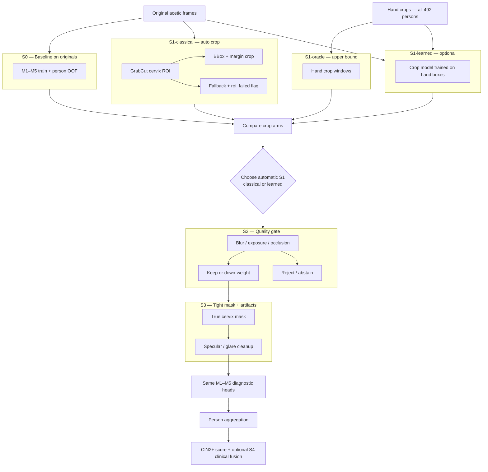
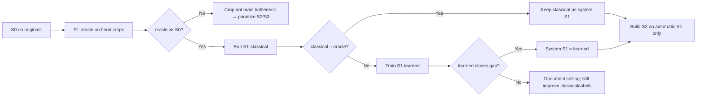

# Cascade system flowchart

## End-to-end modules



## S1 decision tree (uses oracle)



## Result slot flow (for paper tracking)

```text
results/S0_original/{M1..M5}/
results/S1_oracle/{M1..M5}/
results/S1_classical/{M1..M5}/
results/S1_learned/{M1..M5}/   ← fill if trained
results/comparisons/           ← ΔAUROC tables, IoU vs hand box
results/S2_quality/...
results/S3_artifact/...
        ↓
paper/tables/  paper/figures/
```
